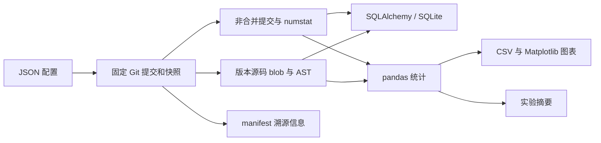

# 设计与实现

## 需求

输入本地 Git 仓库、时间窗口、固定历史 ref、版本快照与源码前缀，输出可核验的提交统计和源码演化结果。单人命令行项目使用 SQLite，无额外数据库服务或 Web 服务依赖。

## 模块

| 模块 | 职责 |
| --- | --- |
| config.py | 解析 JSON、验证范围与路径，按配置位置解析相对路径 |
| git_data.py | 读取提交和文件差异、解析 NUL 分隔重命名记录、读取版本 blob |
| ast_metrics.py | 按编码声明解码 Python 源码，提取结构指标并记录解析失败 |
| storage.py | 建表、保存实验与各类明细，事务性替换同 ID 数据 |
| analysis.py | 生成月度、作者、热点、快照和结构关联数据表 |
| reporting.py | 无界面绘图和根据实际数据生成 Markdown 摘要 |
| pipeline.py | 固定输入、协调采集与输出、生成 manifest |
| cli.py | 命令行入口与可读错误 |

## 数据流

## 关键决策

1. 使用 Git Unix 时间戳，避免真实 Requests 早期历史中异常时区导致 ISO 日期解析失败；归月采用 UTC 提交时间。
2. 不用 `git log --since` 裁剪遍历，先读取固定 ref 全部可达非合并提交，再按时间筛选，避免时钟倒退影响历史遍历。
3. 从 Git 对象读取内容，不进行 checkout。上游工作区状态不会因分析改变，也不会导入或执行被分析代码。
4. 使用 `--numstat -z -M` 解析含空白、Unicode、换行和重命名的路径。删除、二进制与重命名均保留明细；行数在二进制记录中为空。
5. 按快照而非每个历史提交运行 AST，减少重复解析工作。解析失败不按零混入平均值。
6. 去除源码路径的 `src/` 前缀，以关联 Requests 包目录迁移前后的常见路径。这是针对研究对象的规则，并非通用重命名谱系算法。
7. 数据库实验 ID 由固定哈希、时间窗口、源码前缀、指标版本和核心环境计算。更改指标定义时应递增 metrics_version；更改实现发布时应更新工具版本。
8. SQLite 写入使用事务，重复运行替换同一实验数据，避免重复计数。原始明细与汇总 CSV 均可追溯到 commit_hash。

## 复杂度与边界

设固定 ref 可达的非合并提交数为 H、窗口内提交数为 C、文件变更明细数为 D、选定版本源码总字节数为 S。元数据遍历约 O(H)，差异采集调用 C 次 Git，成本还受上游 diff 规模影响；AST 约 O(S)。当前实现将明细装入内存，空间主要由 O(H + D + S) 决定，适合课程中的单仓库样本，尚未针对超大型仓库做流式优化。

图表用英文坐标避免跨平台缺少中文字体，摘要和说明采用中文。首次全量下载取决于网络；有本地仓库后，主流程完全离线。

第一版未实现 Issue 采集、模糊测试、多项目对比和网站，扩展时应在已有主线通过验证后加入。
