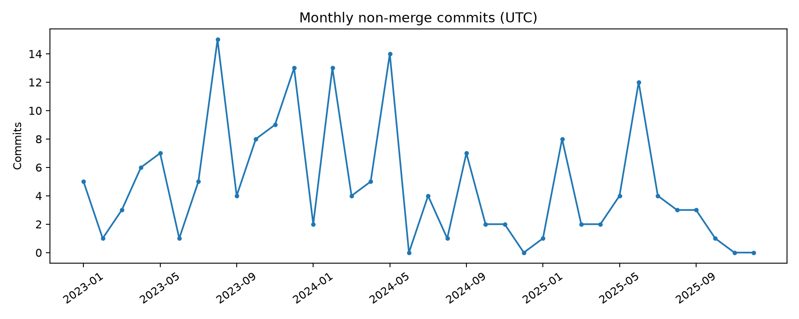
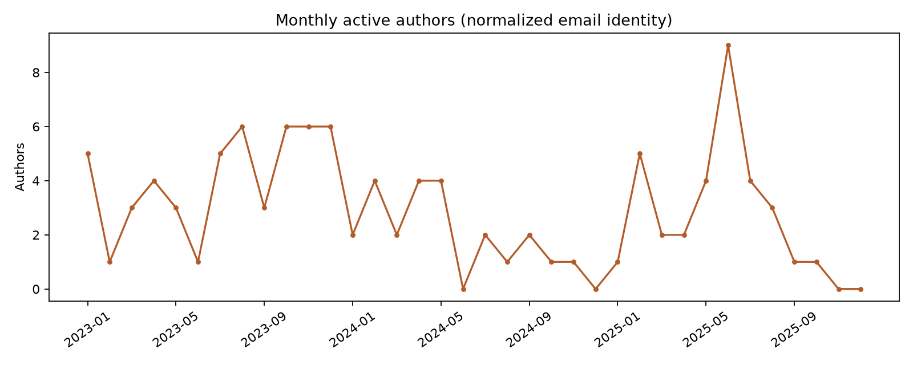
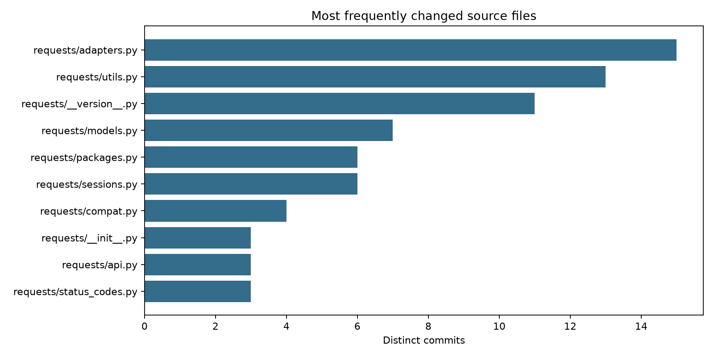
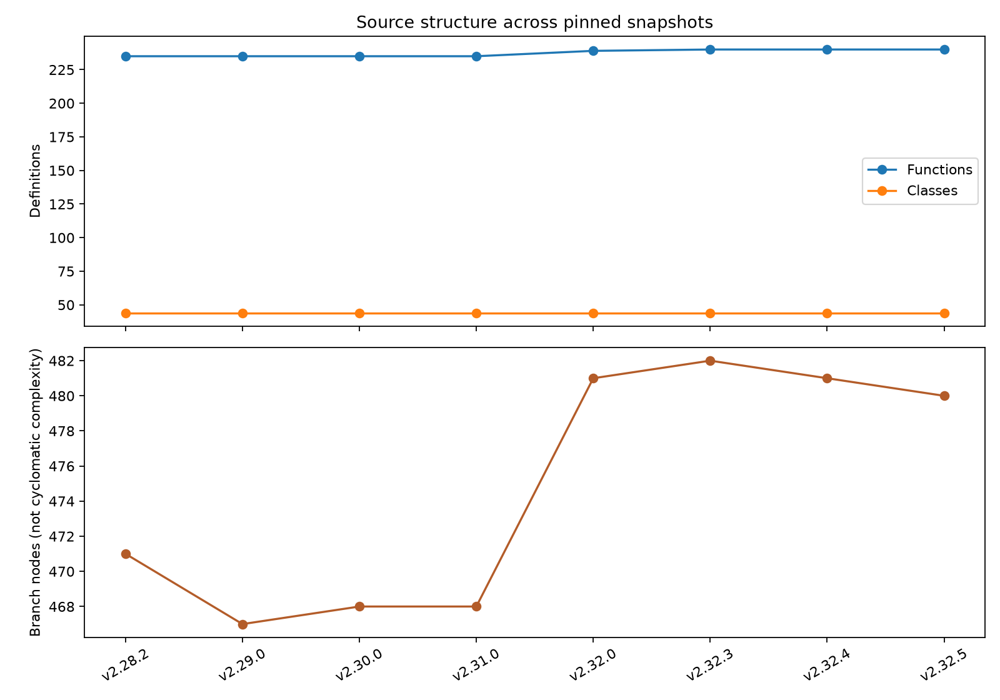
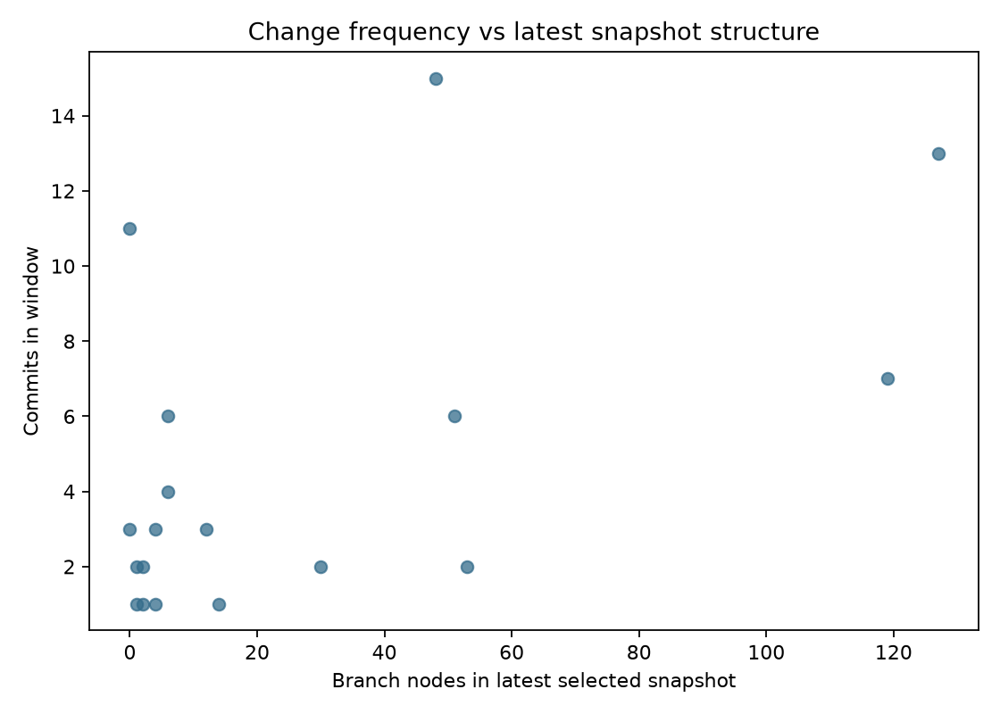

# 实验结果摘要

本文件由程序根据实际数据自动生成，是课程报告的数据素材。

- 实验标识：`7ef353766b5e21a2f3a2`
- 上游固定提交：`3c7baaa05ab4aa49cc819ce3a819d260de19c157`
- 时间窗口（UTC，左闭右开）：`2023-01-01T00:00:00+00:00` 至 `2026-01-01T00:00:00+00:00`
- 非合并提交：171 条；提交者身份：56 个。
- 源码变更记录：83 条。
- 版本快照：8 个；源码解析失败：0 个文件快照。
- 活跃月份：32/36。

## 高频修改源码文件

| 文件（规范化路径） | 涉及提交数 | 增删行总量 |
| --- | --- | --- |
| requests/adapters.py | 15 | 402 |
| requests/utils.py | 13 | 76 |
| requests/__version__.py | 11 | 42 |
| requests/models.py | 7 | 23 |
| requests/packages.py | 6 | 41 |

## 图表

## 统计口径与局限

1. 提交来自固定 ref 可达历史，排除多父节点合并提交，按 Git Unix 提交时间戳转换为 UTC 后筛选；不使用作者时间归月。这样也能处理历史提交中的异常时区偏移。月份边界按配置裁剪，空月份保留为零。
2. 作者身份按邮箱去首尾空格并转小写，空邮箱回退作者名；未合并不同邮箱的同一人，也未过滤机器人。因此身份数不等于真实人数。
3. 增删行数来自 Git `--numstat -M`，二进制文件以空数值表示并单独计数。源码热点只包含配置源码前缀下的 `.py` 文件。
4. Git 重命名检测为启发式。将 `src/` 前缀去除以对应 Requests 的包路径迁移，保留原始路径。更复杂的文件拆分、合并和重命名不自动追溯到单一历史实体。
5. AST 指标包含嵌套函数、异步函数和方法。物理行数包括空行与注释；函数长度按 def 至 end_lineno 计算，包含函数体内部空行和注释，不包含装饰器行。嵌套函数的行数可能同时计入外层函数。
6. 分支节点统计 If、For、AsyncFor、While、IfExp、ExceptHandler、match_case；不统计布尔短路或推导式过滤。这是结构计数，不是圈复杂度。
7. AST 解析受当前 Python 语法支持范围影响；失败记录在 file_metrics.csv，快照汇总只累加解析成功的文件，并显示覆盖量。
8. 热点与结构图仅包含最后一个快照仍存在且解析成功的匹配文件；已删除文件不进入该图。该图描述关联，不能证明缺陷或因果关系。
9. 版本快照不是所有中间提交，无法反映窗口内每次结构变化。manifest.json 记录固定哈希、配置口径和运行环境。

具体数值见同目录 CSV。正式课程报告还需要围绕研究问题加入人工核验、解释和引用。
